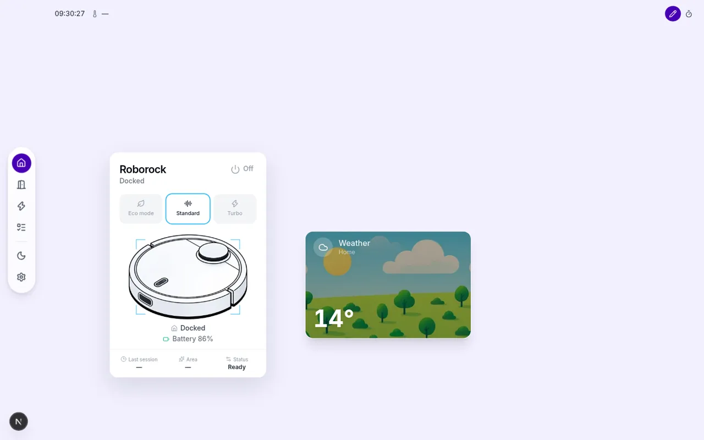
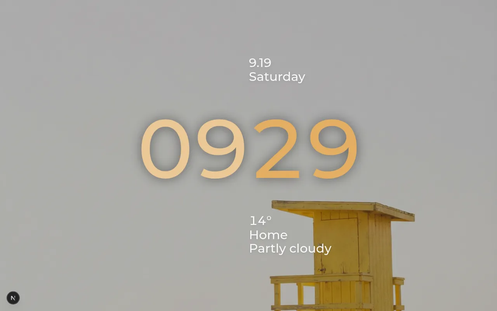
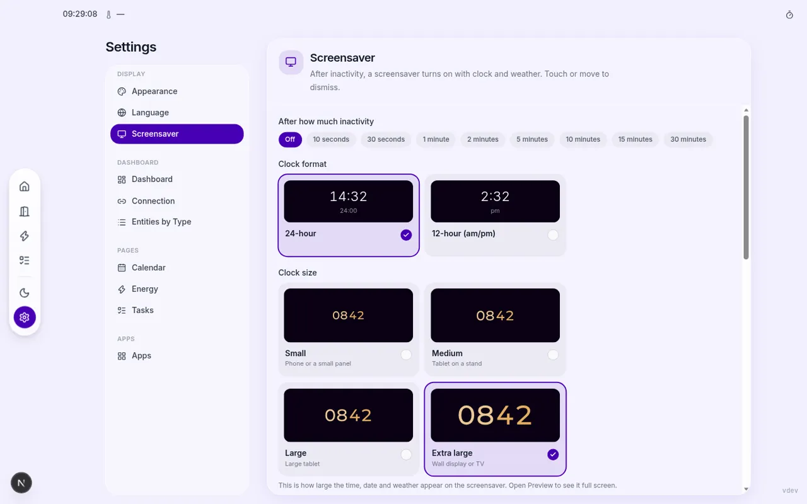
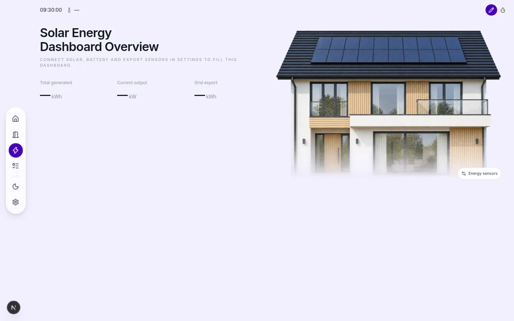

# Home Assistant Dashboard Builder

**A touch-first, no-code dashboard for Home Assistant, built for wall tablets.**

[](LICENSE)
[](https://github.com/hiddevanbrussel/Dashboard-Home-Assistant/releases)
[](#home-assistant-add-on-recommended)
[](https://github.com/hiddevanbrussel/Dashboard-Home-Assistant/pkgs/container/dashboard-home-assistant)
[](https://buymeacoffee.com/hiddevanbrussel)



**[Install](#installation)** · **[Features](#features)** · **[Configuration](#configuration)** · **[Upgrading to 0.5.0](#upgrading-to-050)** · **[Troubleshooting](#troubleshooting)**

---

## Why this dashboard

- **Built for always-on tablets.** Designed for touch in landscape, and developed and tested on a Xiaomi Redmi Pad SE.
- **No YAML.** Drag cards into place, resize them and swipe between pages.
- **A screensaver that's a clock.** After idle time the dashboard becomes a lock-screen clock with weather and what's playing.
- **English and Dutch.**

This is a personal project under active development (pre-1.0).

## Screenshots

<p>


</p>



<!-- TODO: add dark-theme screenshots (Home, Rooms, Calendar, Music, Family, login) taken on the tablet at 1920×1200, without the Next.js dev indicator. -->

---

## Features

### Dashboard & editing
- Free-form dashboard: drag and resize cards in edit mode, with an optional edit passcode.
- Up to six swipeable Home pages.
- A wallpaper per light/dark theme, an accent colour, and adjustable glass density.
- Button sounds, an offline indicator, and an installable web app (PWA manifest).

### Cards
Add cards in edit mode. These are the cards you can add today:

| Card | What it shows |
|---|---|
| Light | On/off, brightness, colour and colour temperature |
| Climate | Temperature gauge, with swiping between climate entities |
| Media | Now playing with controls; opens the music player |
| Weather | Current conditions; tap for the hourly or weekly forecast |
| Vacuum | Robot status and a control sheet (Valetudo map when configured) |
| Calendar | Date strip, agenda and upcoming events |
| Tasks | Family chore summary |
| Room | Shortcut into a room |
| Camera | Camera snapshot from Home Assistant |
| Trash pickup | Next pickup dates per waste type |
| Team Tracker | Next or live match from a Team Tracker sensor |
| Timer | Kitchen timer |
| Usage chart | Weekly or monthly bar chart for consumption or production |
| Smart Stack | Several cards stacked in one place |
| Stat pill | A single value with an icon |
| Text / Image | Labels and images (an image can change with an entity state) |

### Pages
Turn extra pages on in Settings when you need them:

| Page | What it does |
|---|---|
| **Rooms** | Rooms grouped by floor. Swipe between floors, then open a room board with the same editor |
| **Energy** | Solar, grid and battery overview, a house scene, and an editable energy board |
| **Calendar** | Day, week and month views from Home Assistant calendars |
| **Family / Tasks** | Children, chores, points, streaks and a rewards shop. Works **without** Home Assistant |
| **Music** | Music Assistant home (search, shelves, player), with a Home Assistant media-player fallback |
| **Vacuum** | Full-page Valetudo map and room cleaning |

### Screensaver
- Clock in four sizes and nine positions, 12- or 24-hour, with a full-screen preview in Settings.
- Weather, now playing from a chosen speaker, an optional live football overlay, and a running timer.
- Background: an uploaded image, Pexels photos/videos, or your own Immich library.

### Header & voice
- Clock, weather, energy stats, optional RSS news, a timer, notifications and now playing.
- **Voice Satellite:** tap-to-talk with Assist, or an on-device wake word, using your Home Assistant voice pipeline.

### Integrations
Home Assistant (add-on auto-link, IndieAuth login or a long-lived token, LAN discovery), Music Assistant, Valetudo, Immich, Pexels, RSS news, and a doorbell pop-up.

### Security (0.5.0)
- Direct access is protected by a login with `DASHBOARD_PASSWORD`. Home Assistant Ingress doesn't ask for it.
- Integration secrets are stored encrypted on the server.
- Server-side fetches are restricted to safe destinations.

---

## Requirements

- Requires Home Assistant 2024.8 or newer. Older versions mostly work, but the weather forecast stays empty on 2024.3–2024.7, and Assist needs 2023.5+.
- Home Assistant reachable from where the dashboard runs.
- One of:
  - Home Assistant OS or Supervised, for the add-on;
  - a Docker host;
  - Unraid.
- **Architectures:** amd64 and arm64/aarch64 (Home Assistant Green, Raspberry Pi), from **v0.5.0**. Images are published per version tag.
- A tablet or other device with a modern browser.

---

## Installation

### Home Assistant add-on (recommended)

1. **Settings → Apps → App Store** (or **Settings → Add-ons** on older versions) → ⋮ → **Repositories**.
2. Add `https://github.com/hiddevanbrussel/Dashboard-Home-Assistant`.
3. Install **Dashboard Builder**.
4. **Before the first start**, open **Configuration**:
   - Set `dashboard_password` to at least 12 characters, not on the short denylist. The add-on exits if it's empty or too weak.
   - Leave `app_secret` **empty**. A stable secret is generated and kept in `/data/app_secret`.
5. Start the add-on and open **Open Web UI** (Ingress) or the sidebar entry. Home Assistant **links automatically** via the Supervisor: no URL or token needed.
6. Optional: tablets on your LAN can open `http://HOME_ASSISTANT_IP:3000/` and sign in once with the dashboard password.

All options: [`homeassistant-addon/DOCS.md`](homeassistant-addon/DOCS.md).

### Docker Compose

1. Generate `APP_SECRET` **once** and keep it:
   ```bash
   openssl rand -hex 32
   ```
2. Create a `.env` file next to `docker-compose.yml` (don't commit it):
   ```env
   APP_SECRET=<the secret you saved>
   DASHBOARD_PASSWORD=<at least 12 characters>
   ```
3. Create `docker-compose.yml`:
   ```yaml
   services:
     ha-dashboard:
       image: ghcr.io/hiddevanbrussel/dashboard-home-assistant:latest
       container_name: ha-dashboard
       restart: unless-stopped
       ports:
         - "3000:3000"
       volumes:
         - ha-dashboard-data:/data
       environment:
         - APP_SECRET=${APP_SECRET:?Set APP_SECRET to the output of openssl rand -hex 32}
         - DASHBOARD_PASSWORD=${DASHBOARD_PASSWORD:?Set DASHBOARD_PASSWORD to a passphrase of at least 12 characters}
         - PEXELS_API_KEY=              # optional
         - IMMICH_URL=                  # optional, e.g. http://192.168.1.50:2283
         - IMMICH_API_KEY=              # optional
         - MUSIC_ASSISTANT_URL=         # optional, e.g. http://192.168.1.50:8095
         - MUSIC_ASSISTANT_TOKEN=       # optional

   volumes:
     ha-dashboard-data:
   ```
4. Start it with `docker compose up -d`. Compose refuses to start when either variable is missing.
5. Open `http://<host>:3000`, sign in with the dashboard password, and follow onboarding.

### docker run

Generate `APP_SECRET` once and keep it. Don't put `$(openssl rand -hex 32)` in a command you run again: a new secret makes the saved Home Assistant connection unreadable.

```bash
docker run -d \
  --name ha-dashboard \
  --restart unless-stopped \
  -p 3000:3000 \
  -v ha-dashboard-data:/data \
  -e APP_SECRET="paste-the-secret-you-saved" \
  -e DASHBOARD_PASSWORD="choose-a-long-passphrase" \
  ghcr.io/hiddevanbrussel/dashboard-home-assistant:latest
```

### Unraid

1. **Apps → Add Container**, or import [`unraid-template.xml`](unraid-template.xml).
2. Repository: `ghcr.io/hiddevanbrussel/dashboard-home-assistant:latest`
3. Map port **3000**, and set `/data` to an appdata folder (e.g. `/mnt/user/appdata/dashboard`).
4. Fill in the required `APP_SECRET` (`openssl rand -hex 32`, generate once and keep it) and `DASHBOARD_PASSWORD` (at least 12 characters, different from `APP_SECRET`).
5. Optional: `PEXELS_API_KEY`, `IMMICH_URL` + `IMMICH_API_KEY`, `MUSIC_ASSISTANT_URL` + `MUSIC_ASSISTANT_TOKEN`.

### Build from source (developers)

See [CONTRIBUTING.md](CONTRIBUTING.md). In short:
- Node.js 20 or newer.
- `cp .env.example .env`, then set `APP_SECRET` and `DASHBOARD_PASSWORD`.
- `export DATABASE_URL="file:./prisma/dev.db"`. Prisma 7 doesn't read `.env` for the CLI.
- `npm install`, then `npm run dev`.

---

## First run: connecting Home Assistant

- **Add-on:** links automatically via the Supervisor.
- **Docker / Unraid:** after signing in, onboarding searches your network for Home Assistant. Then **Log in with Home Assistant** (IndieAuth) or paste a long-lived access token.

To create a long-lived token: in Home Assistant, open your **Profile** → **Long-Lived Access Tokens** → **Create token**, and copy it (it's shown only once).

| Setup | URL example |
|---|---|
| Local hostname | `http://homeassistant.local:8123` |
| IP address | `http://192.168.1.10:8123` |
| HTTPS / reverse proxy | `https://ha.yourdomain.com` |

`http` is allowed for localhost, private IPs, the host names `homeassistant` and `supervisor`, names ending in `.local`, `.lan`, `.home` or `.internal`, and other single-label hosts. A **public** `http` URL is rejected.

---

## Configuration

### Required
| Variable | Add-on option | Description |
|---|---|---|
| `APP_SECRET` | `app_secret` (leave empty) | Random encryption secret, at least 32 characters. Known placeholders and values with fewer than 8 different characters are rejected. Changing it requires saving the Home Assistant connection again. |
| `DASHBOARD_PASSWORD` | `dashboard_password` | Password for browsers that open the dashboard directly. At least 12 characters, and different from `APP_SECRET`. Exact denylist words are rejected, in any case. Home Assistant Ingress doesn't ask for it. |

### Optional integrations
| Variable | Add-on option | Description |
|---|---|---|
| `PEXELS_API_KEY` | `pexels_api_key` | Free key from [pexels.com/api](https://www.pexels.com/api/) for screensaver media |
| `IMMICH_URL` | `immich_url` | Immich base URL. Takes priority over Settings |
| `IMMICH_API_KEY` | `immich_api_key` | Immich API key. Takes priority over a browser-stored key |
| `MUSIC_ASSISTANT_URL` | `music_assistant_url` | Music Assistant base URL. Takes priority over Settings |
| `MUSIC_ASSISTANT_TOKEN` | `music_assistant_token` | Music Assistant API token. Takes priority over a browser-stored token |
| `NEXT_PUBLIC_DEFAULT_LANGUAGE` | `default_language` | Default UI language: `en` or `nl` |
| `NEXT_PUBLIC_APP_NAME` | — | App name shown in the browser title |
| `DATABASE_URL` | — | SQLite path (default: `file:/data/app.db`) |

### Advanced / reverse proxy
| Variable | Description |
|---|---|
| `APP_PUBLIC_ORIGIN` | Public https origin used as the Home Assistant login client id, e.g. `https://dashboard.example.com` |
| `TRUST_PROXY` | Set to `1` behind your own reverse proxy, so the client IP (`X-Real-IP` / `X-Forwarded-For`) and `X-Forwarded-Proto` are trusted. The add-on doesn't need this; it sets `HA_ADDON=1`. |
| `DOORBELL_ALLOWED_HOSTS` | Comma-separated https hosts allowed for a doorbell page that isn't on the local network |
| `UPDATE_PASSCODE` | At least 20 characters to enable Settings → System → Install update. Leave it unset to keep that button off; updating the container image is preferred. |

---

## Tablet tips

- Use the tablet in landscape and add the dashboard to the home screen (it ships a web app manifest).
- Set the screensaver under **Settings → Screensaver**. The Extra large clock is meant for wall tablets.
- Sign in once per tablet on port 3000. The session lasts 90 days.

- For a full-screen wall tablet on Android, the developer uses [Kiosk Satellite](https://kiosksatellite.com/) on the Xiaomi Redmi Pad SE. Point it at your dashboard URL. Kiosk Satellite is a separate app (Android 7.0+, free for personal, non-commercial use); see its site for setup.

---

## Updating

Images are published when a version tag `v*.*.*` is pushed. A stable tag (`vX.Y.Z`) builds amd64 and arm64/aarch64 for the app and the add-on, and moves `latest` and the minor tag (`X.Y`). A beta tag (`vX.Y.Z-beta.N`) publishes only the app tags `:X.Y.Z-beta.N` and `:beta`. It does not move `:latest` or `:X.Y`, and it does not build the add-on. A push to `main` doesn't publish images. See [RELEASING.md](RELEASING.md).

- **Docker Compose:**
  ```bash
  docker compose pull
  docker compose up -d --force-recreate
  ```
  A plain `docker pull` isn't enough: the container has to be recreated.
- **Unraid:** open the container → **Force update**, and check **Settings → System** for the new version.
- **Add-on:** **Settings → Add-ons → Add-on store** → ⋮ → **Check for updates**, then update **Dashboard Builder**.

### Upgrading to 0.5.0

0.5.0 adds a login and **won't start** until both secrets are set.

1. **Back up first:**
   - add-on: a partial backup of **Dashboard Builder**;
   - Docker: the volume;
   - Unraid: stop the container first, then back up the appdata folder.
2. **Set the secrets:**
   - **Add-on:** fill in `dashboard_password` and leave `app_secret` empty.
   - **Compose:** create `.env` with `APP_SECRET` (generated once with `openssl rand -hex 32`, then kept) and `DASHBOARD_PASSWORD`.
   - **Unraid:** add both variables, and check that `DATABASE_URL=file:/data/app.db` is set. If your container already has an `APP_SECRET` of at least 32 characters that isn't a placeholder, reuse it.
3. **Update.** The database migration runs automatically at start.
4. **Sign in once on every tablet** that uses port 3000. Open the dashboard once in each browser while signed in, so stored Immich, Music Assistant, Pexels and Valetudo keys move to the server. If they're gone, enter them again in Settings.
5. **If `APP_SECRET` is new,** re-save the Home Assistant connection in **Settings → Home Assistant**.

> **Running on `:latest`?** Every version tag also updates `latest`. Pin a fixed tag first if you don't want to jump to 0.5.0 on the next pull or auto-update. To test 0.5.0 next to your current setup, use a second container with its own name, a copy of the appdata folder, another host port and the `:0.5.0` tag. A different port is a different browser origin, so browser-stored keys don't carry over.

Full details are in the [0.5.0 release notes](https://github.com/hiddevanbrussel/Dashboard-Home-Assistant/releases) and [`homeassistant-addon/CHANGELOG.md`](homeassistant-addon/CHANGELOG.md).

---

## Security

- Keep the dashboard on your LAN, or publish it only through a reverse proxy you control (with `TRUST_PROXY=1`). Keep port 3000 off the public internet.
- Direct access requires the dashboard password. Home Assistant Ingress is trusted and only accepts the Supervisor.
- `APP_SECRET` encrypts stored secrets, including the Home Assistant token.
- Report vulnerabilities privately; see [SECURITY.md](SECURITY.md).

---

## Troubleshooting

| Problem | What to do |
|---|---|
| **Container exits at start** | Check the log for `[startup]`. `APP_SECRET` or `DASHBOARD_PASSWORD` is missing, too short, a placeholder, on the denylist, or both are the same. |
| **Add-on won't start** | `dashboard_password` is empty or too weak (log: `[addon] Set dashboard_password…`). |
| **Home Assistant connection lost after an update** | `APP_SECRET` changed. Re-save the connection in Settings → Home Assistant. |
| **Immich / Music Assistant / Pexels / Valetudo stopped working** | Open the dashboard once while signed in in the browser that had the keys, or enter them again in Settings. |
| **Invalid token** | Create a new long-lived access token and enter it in Settings. |
| **Mixed content warning** | If the dashboard runs on HTTPS, the Home Assistant URL must be HTTPS too, or go through a reverse proxy. |
| **Can't reach Home Assistant** | All HA calls are made server-side. The HA URL must be reachable from the container, not just from your browser. |
| **Uploads or settings lost after a restart** | Make sure `/data` is mounted as a volume. |

---

## FAQ

**Does it change my Lovelace dashboards or Home Assistant configuration?**
No. It doesn't create or change dashboards, helpers, entities, automations, scripts, scenes, config entries or files in Home Assistant. Everything it stores lives in its own database (`/data/app.db`), and the add-on only has `homeassistant_api` access. It controls devices only when you tap them: lights, climate, media, vacuum, alarm, switches and speaker grouping.

Worth knowing:
- It only calls Home Assistant services after you tap or interact with something on the dashboard.
- On Docker or Unraid, each **Log in with Home Assistant** creates a long-lived token called "Dashboard Builder" in your HA profile. Old tokens aren't revoked automatically; you can remove them under **Profile → Long-Lived Access Tokens**. The add-on uses the Supervisor token instead.
- Voice requests go through your Home Assistant Assist pipeline.

**Does it run on a Raspberry Pi or Home Assistant Green?**
Yes. From v0.5.0 every stable release is published for amd64 and arm64/aarch64, for both the add-on and the Docker image. A beta tag publishes the Docker image only (`:X.Y.Z-beta.N` and `:beta`), not the add-on. See [RELEASING.md](RELEASING.md).

**Do I need Home Assistant?**
Yes, for everything except the Family/Tasks page.

---

## Contributing

Bug reports, ideas and pull requests are welcome. See [CONTRIBUTING.md](CONTRIBUTING.md) for local setup, tests (`npm test`, Vitest) and how to file issues.

## Support

- Issues: https://github.com/hiddevanbrussel/Dashboard-Home-Assistant/issues
- If you like the project: [Buy me a coffee](https://buymeacoffee.com/hiddevanbrussel)

## Fonts

The interface uses [Google Sans](https://github.com/google/fonts/tree/main/ofl/googlesans) (Latin, variable weight axis 400–700), self-hosted from `@fontsource-variable/google-sans`. Google Sans is licensed under the SIL Open Font License 1.1. Copyright 2025 The Google Sans Project Authors (https://github.com/googlefonts/googlesans). See [OFL.txt](OFL.txt).

Clock digits and the screensaver use [Montserrat](https://github.com/JulietaUla/Montserrat) (latin subset only; weights 500, 600, 800 and 900), self-hosted with `next/font/local` from `src/fonts/montserrat/`. Montserrat is licensed under the SIL Open Font License 1.1. Copyright 2024 The Montserrat.Git Project Authors (https://github.com/JulietaUla/Montserrat.git). See [src/fonts/montserrat/OFL.txt](src/fonts/montserrat/OFL.txt). The Docker image and the add-on image also copy that file to `/usr/share/licenses/montserrat/OFL.txt`.

## License

[GPL-3.0-only](LICENSE) © Hidde van Brussel

<sub>Not affiliated with or endorsed by Home Assistant or the Open Home Foundation.</sub>
